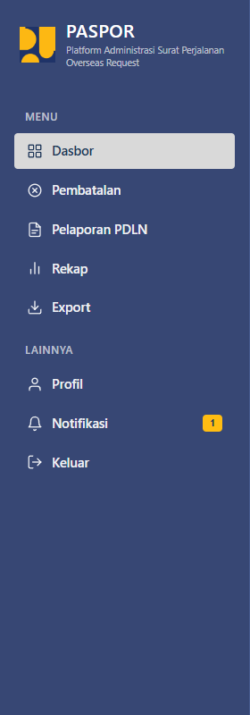
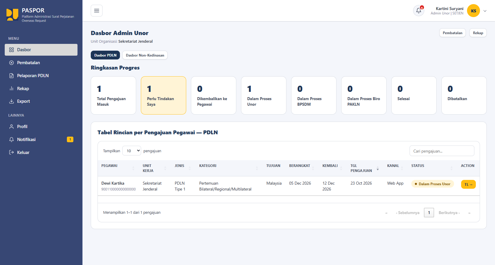
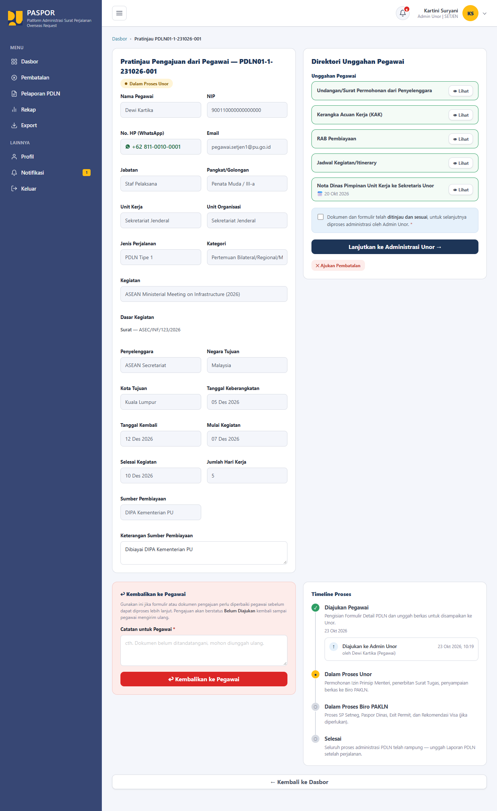
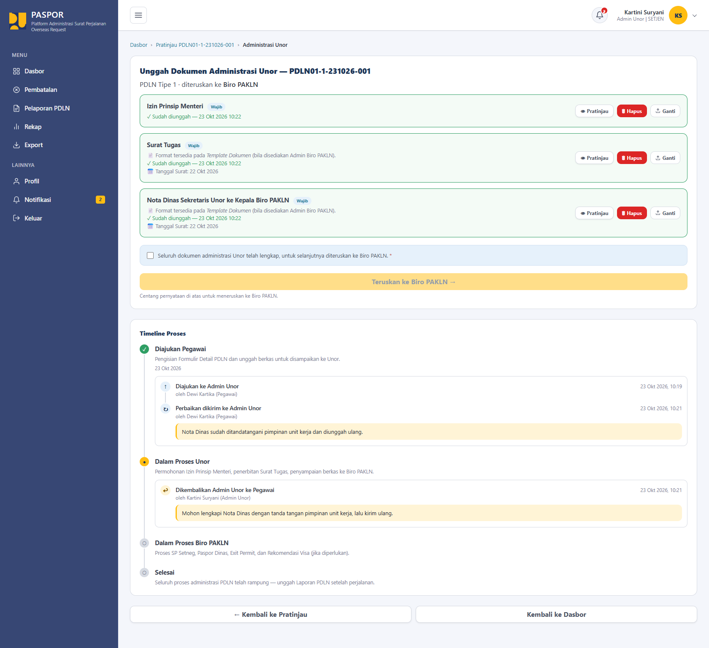
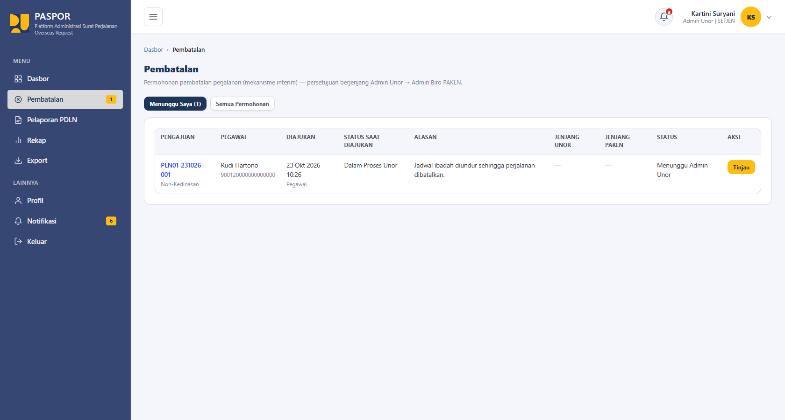
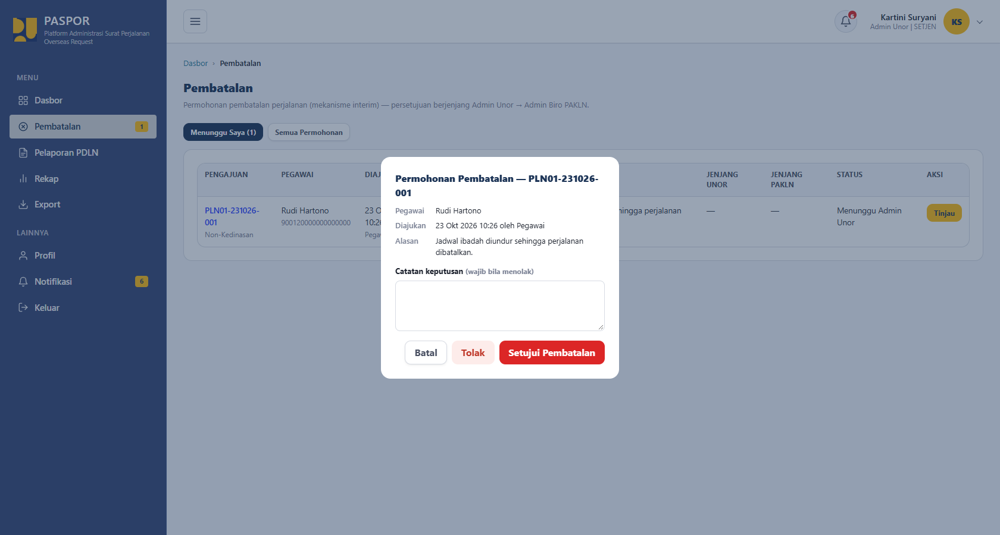
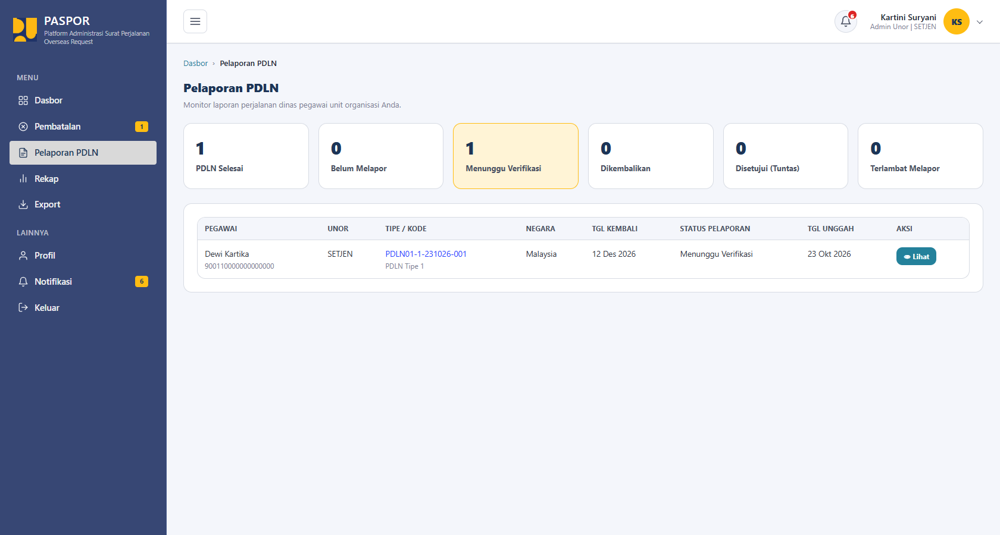
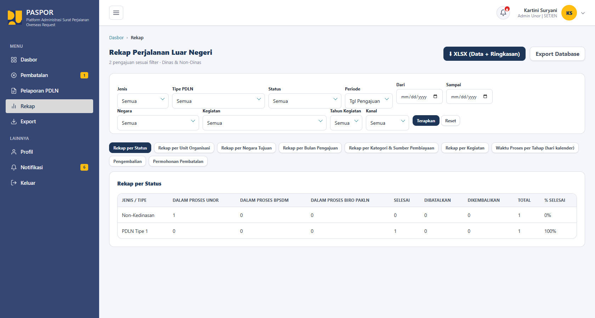
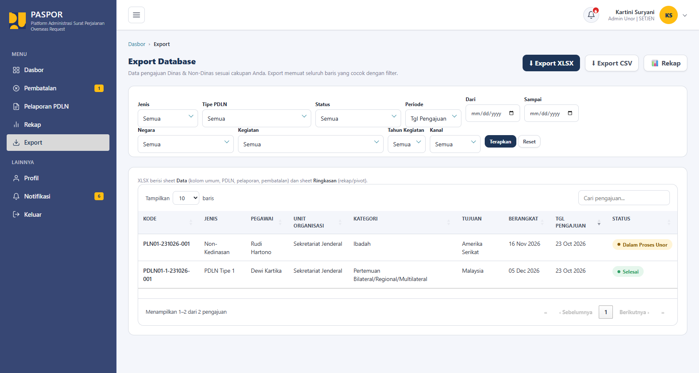

# Panduan Pengguna: Admin Unor

Bagian ini menjelaskan tugas Admin Unor dalam memproses pengajuan pegawai di unit organisasinya. Untuk login, profil, dan notifikasi, lihat [Akses, Akun, dan Profil](README.md#2-akses-akun-dan-profil).

## Daftar Isi

1. [Deskripsi Peran](#1-deskripsi-peran)
2. [Menu Sidebar](#2-menu-sidebar)
3. [Aturan Khusus Admin Unor](#3-aturan-khusus-admin-unor)
4. [Tugas pada Setiap Menu](#4-tugas-pada-setiap-menu)

---

## 1. Deskripsi Peran

Admin Unor **memeriksa pengajuan dan dokumen pegawai di unit organisasinya saja**. Semua jenis dan tipe pengajuan (Non-Kedinasan maupun PDLN) di unit tersebut dapat Anda lihat.

Admin Unor **tidak**:

- memverifikasi data pegawai;
- mengelola user;
- mengelola template;
- mengelola data negara.

---

## 2. Menu Sidebar

| Menu | Fungsi |
|---|---|
| **Dasbor** | Ringkasan dan tabel pengajuan pegawai unit. |
| **Pembatalan** | Memutuskan dan mengajukan pembatalan. |
| **Pelaporan PDLN** | Memantau laporan pegawai unit. |
| **Rekap** | Statistik pengajuan. |
| **Export** | Mengunduh data pengajuan. |
| **Profil** dan **Notifikasi** | Lihat [Bagian 2 pada README](README.md#2-akses-akun-dan-profil). |

> **Catatan:** Angka kuning pada menu menunjukkan jumlah item yang perlu tindakan Anda, misalnya permohonan pembatalan yang menunggu keputusan.

---

## 3. Aturan Khusus Admin Unor

- **Tidak boleh memproses pengajuan milik dirinya sendiri** (Aturan AB-12). Bila Anda juga seorang pegawai, pengajuan Anda harus diproses oleh admin lain.
- Anda hanya melihat pengajuan pegawai di **unit organisasi yang Anda kelola**. Nama unit tampil di bagian atas Dasbor.

---

## 4. Tugas pada Setiap Menu

### 4.1 Dasbor

Dasbor menampilkan:

- tab **Dasbor PDLN** dan **Dasbor Non-Kedinasan**;
- **Ringkasan Progres**: Total Pengajuan Masuk, Perlu Tindakan Saya, Dikembalikan ke Pegawai, Dalam Proses Unor, Dalam Proses BPSDM, Dalam Proses Biro PAKLN, Selesai, dan Dibatalkan;
- **Tabel Rincian per Pengajuan Pegawai** (Pegawai, Unit Kerja, Jenis, Kategori, Tujuan, Berangkat, Kembali, Tgl Pengajuan, Kanal, Status, Action), dengan fitur **cari**, **urut** (klik judul kolom), dan pengaturan jumlah baris yang ditampilkan.
- tombol pintasan **Pembatalan** dan **Rekap**.

### 4.2 Pratinjau

1. Pada tabel Dasbor, klik tombol aksi pada pengajuan yang akan diperiksa untuk membuka halaman **Pratinjau**.
2. Tinjau **formulir** di sisi kiri dan **Direktori Unggahan Pegawai** di sisi kanan. Klik **Lihat** untuk membuka setiap berkas. Halaman ini bersifat hanya baca.
3. **Timeline Proses** di bagian bawah menampilkan riwayat pengajuan, termasuk catatan pengembalian sebelumnya.
4. Pilih salah satu:
   - **Menyetujui:** centang pernyataan **"Dokumen dan formulir telah ditinjau dan sesuai..."**, lalu klik **Lanjutkan ke Administrasi Unor**.
   - **Mengembalikan ke pegawai:** isi **Catatan untuk Pegawai** (wajib), klik **Kembalikan ke Pegawai**, lalu klik **Kembalikan** pada dialog konfirmasi.

> **Penting:** Catatan wajib diisi saat mengembalikan pengajuan. Setelah dikembalikan, status pengajuan menjadi **Belum Diajukan** sampai pegawai mengirim ulang, dan pegawai menerima notifikasi.

### 4.3 Unggah Dokumen Administrasi

Setelah mencentang persetujuan dan mengklik **Lanjutkan ke Administrasi Unor**, Anda masuk ke halaman **Unggah Dokumen Administrasi Unor**.

1. Pada setiap baris dokumen wajib, klik **Unggah** lalu pilih berkas PDF. Berkas **langsung tersimpan** begitu dipilih.
2. Bila dokumen meminta **Tanggal Surat**, isi tanggal pada dialog yang muncul, lalu klik **Simpan**.
3. Dokumen yang sudah diunggah menampilkan tombol **Pratinjau**, **Hapus**, dan **Ganti**. Klik **Hapus** bila ada dokumen yang salah, lalu unggah ulang berkas yang benar.
4. Bila format dokumen disediakan, tertulis "Format tersedia pada *Template Dokumen*".
5. Setelah seluruh dokumen wajib lengkap, centang pernyataan kelengkapan, lalu klik tombol **Teruskan** dan konfirmasi.

**Dokumen wajib tahap Unor** (contoh):

| Tipe | Dokumen |
|---|---|
| **PDLN Tipe 1** | Izin Prinsip Menteri; Surat Tugas; Nota Dinas Sekretaris Unor ke Kepala Biro PAKLN |
| **PDLN Tipe 3** | Izin Prinsip/Disposisi Menteri; Surat Tugas; Nota Dinas Sekretaris Unor ke Kepala Biro PAKLN |
| **PDLN Tipe 2 Pendidikan** | Nota Dinas Sekretaris Unor ke Sekretaris BPSDM; Surat Tugas Pimpinan Unor; DRH ttd Pimpinan Unor |
| **PDLN Tipe 2 Pelatihan** | Nota Dinas Sekretaris Unor ke Sekretaris BPSDM; Surat Tugas Pimpinan Unor |
| **Non-Kedinasan** | Sesuai daftar yang tampil pada halaman |

**Tujuan penerusan**

- **PDLN Tipe 2** diteruskan ke **BPSDM**.
- **Selain Tipe 2** diteruskan ke **Biro PAKLN** (tombol **Teruskan ke Biro PAKLN**).

> **Catatan:** Tombol **Teruskan** nonaktif selama dokumen wajib belum lengkap. Halaman menampilkan dokumen yang masih kurang.

### 4.4 Pembatalan

Menu **Pembatalan** memiliki dua tab: **Menunggu Saya** (permohonan yang menunggu keputusan Anda) dan **Semua Permohonan**. Tabel menampilkan Pengajuan, Pegawai, Diajukan, Status Saat Diajukan, Alasan, Jenjang Unor, Jenjang PAKLN, dan Status.

**Menyetujui atau menolak permohonan pegawai**

1. Pada tab **Menunggu Saya**, klik **Tinjau** pada permohonan.
2. Baca rincian permohonan (pegawai, waktu pengajuan, dan alasan).
3. Isi **Catatan keputusan**:
   - klik **Setujui Pembatalan** untuk menyetujui (catatan opsional);
   - klik **Tolak** untuk menolak (catatan **wajib**).

**Mengajukan pembatalan atas nama unit**

Pada halaman **Pratinjau** sebuah pengajuan, klik **Ajukan Pembatalan**, lalu isi alasan. Permohonan yang diajukan Admin Unor dihitung sebagai persetujuan dari sisi unit, lalu menunggu keputusan berikutnya.

**Menarik pembatalan yang Anda ajukan**

Pada permohonan yang Anda ajukan sendiri dan masih berjalan, klik **Tarik**.

> **Penting:** Selama permohonan pembatalan diproses, pengajuan **dibekukan** dan tidak dapat diproses lebih lanjut. Jika permohonan ditolak atau ditarik, pengajuan melanjutkan proses dari status semula.

### 4.5 Pelaporan PDLN

Halaman ini memantau laporan perjalanan dinas pegawai di unit organisasi Anda dan bersifat **hanya baca (read-only)**.

- Kartu ringkasan: PDLN Selesai, Belum Melapor, Menunggu Verifikasi, Dikembalikan, Disetujui (Tuntas), dan Terlambat Melapor.
- Tabel: Pegawai, Unor, Tipe/Kode, Negara, Tgl Kembali, Status Pelaporan, Tgl Unggah, dan Aksi. Klik **Lihat** untuk melihat laporan.

### 4.6 Rekap

Halaman **Rekap Perjalanan Luar Negeri** menampilkan statistik pengajuan di unit Anda (Dinas dan Non-Dinas).

1. Atur **filter** (Jenis, Tipe PDLN, Status, Periode, Negara, Kegiatan, Tahun Kegiatan, Kanal), lalu klik **Terapkan**. Klik **Reset** untuk mengosongkan filter.
2. Pilih tab rekap yang diinginkan: Rekap per Status, per Unit Organisasi, per Negara Tujuan, per Bulan Pengajuan, per Kategori & Sumber Pembiayaan, per Kegiatan, Waktu Proses per Tahap (hari kalender), Pengembalian, dan Permohonan Pembatalan.
3. Klik **XLSX (Data + Ringkasan)** untuk mengunduh hasilnya.

### 4.7 Export

Halaman **Export Database** mengunduh data pengajuan yang sesuai cakupan unit Anda.

1. Atur **filter** (Jenis, Tipe PDLN, Status, Periode beserta rentang tanggal, Negara, Kegiatan, Tahun Kegiatan, Kanal), lalu klik **Terapkan**. Tabel di bawahnya menampilkan data yang akan diekspor.
2. Klik **Export XLSX** atau **Export CSV**.

> **Catatan:** Berkas XLSX berisi sheet **Data** (kolom umum, PDLN, pelaporan, dan pembatalan) dan sheet **Ringkasan**. Export memuat seluruh baris yang cocok dengan filter, bukan hanya halaman yang tampil.
