# Panduan Pengguna: Pegawai

Bagian ini menjelaskan cara Pegawai mengajukan, memantau, melaporkan, dan membatalkan perjalanan luar negeri. Untuk login, profil, dan notifikasi, lihat [Akses, Akun, dan Profil](README.md#2-akses-akun-dan-profil).

## Daftar Isi

1. [Menu Sidebar](#1-menu-sidebar)
2. [Aturan Khusus Pegawai](#2-aturan-khusus-pegawai)
3. [Alur Pengajuan](#3-alur-pengajuan)
4. [Mengusulkan Kegiatan Baru](#4-mengusulkan-kegiatan-baru)

---

## 1. Menu Sidebar

| Menu | Fungsi |
|---|---|
| **Beranda** | Melihat pengajuan aktif dan riwayat, serta membuat usulan baru. |
| **Pelaporan PDLN** | Mengisi dan memantau laporan perjalanan dinas. |
| **Pembatalan** | Melihat dan menarik permohonan pembatalan. |
| **Profil** dan **Notifikasi** | Lihat [Bagian 2 pada README](README.md#2-akses-akun-dan-profil). |

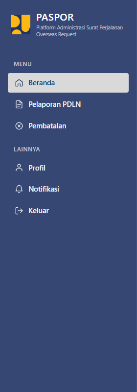

**Beranda** menampilkan:

- tombol **Tambah Usulan Baru** (atau **Lanjutkan Draft** bila ada draft);
- tabel **Pengajuan Aktif** (Jenis, Tujuan, Kategori, Tgl Pengajuan, Status, Action);
- tab **Riwayat PDLN** dan **Riwayat Non-Dinas**, dengan fitur cari;
- tabel **Usulan Kegiatan Saya** bila Anda pernah mengusulkan kegiatan.

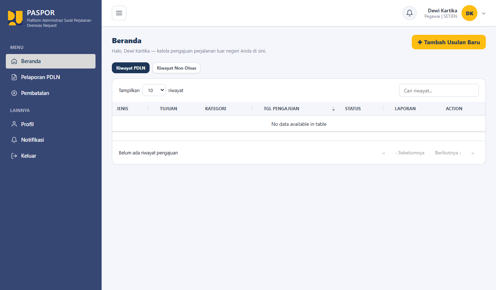

---

## 2. Aturan Khusus Pegawai

1. **Hanya boleh ada satu pengajuan aktif.** Pengajuan baru dapat dibuat jika pengajuan sebelumnya sudah **tuntas** atau **dibatalkan**. Selama pengajuan lama belum tuntas, tombol **Tambah Usulan Baru** nonaktif dan alasannya ditampilkan di Beranda.
2. **Draft juga dihitung sebagai pengajuan aktif.** Lanjutkan draft melalui tombol **Lanjutkan Draft**.
3. **Untuk PDLN**, pengajuan dianggap tuntas setelah **Laporan PDLN disetujui** (lihat [Langkah 7](#langkah-7-pelaporan-pdln-khusus-pdln)).
4. **Mengusulkan kegiatan baru** dapat dilakukan dari formulir PDLN. Keputusan akhir oleh **Admin Biro PAKLN** (lihat [Bagian 4](#4-mengusulkan-kegiatan-baru)).

---

## 3. Alur Pengajuan

### Langkah 1: Pilih jenis usulan

1. Di **Beranda**, klik **Tambah Usulan Baru**.
2. Pilih salah satu jenis:
   - **Perjalanan Luar Negeri Non-Kedinasan**: untuk ibadah, wisata, atau keperluan pribadi lainnya.
   - **Perjalanan Dinas Luar Negeri (PDLN)**: lalu pilih salah satu tipe:
     - **Tipe 1**
     - **Tipe 2 Pendidikan**
     - **Tipe 2 Pelatihan**
     - **Tipe 3**

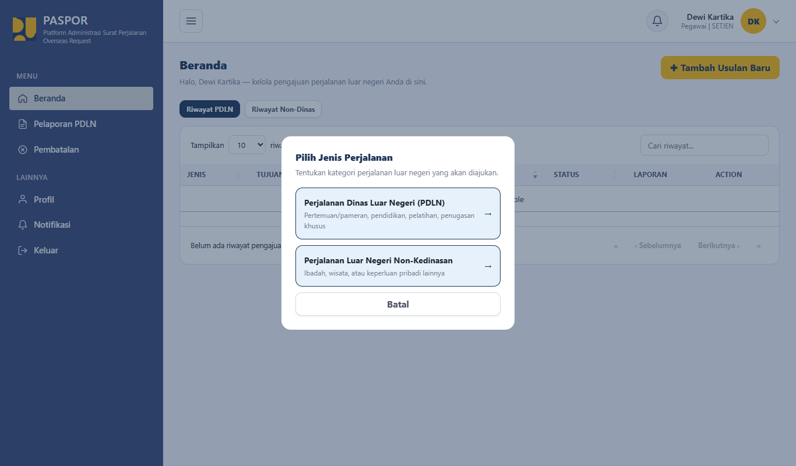

### Langkah 2: Isi formulir pengajuan

Data pegawai (nama, NIP, unit kerja, unit organisasi, dan seterusnya) terisi **otomatis** dan tidak dapat diubah.

**Formulir Non-Kedinasan**

- Bagian atas menampilkan **Sisa Cuti Tahun Berjalan**.
- Isi **Kategori Perjalanan** (pilih dari kategori yang tersedia), **Tujuan Negara**, **Maksud Perjalanan**, **Sumber Pembiayaan**, **Tanggal Keberangkatan**, dan **Tanggal Kembali**.
- **Jumlah Hari Kalender** dan **Jumlah Hari Kerja** dihitung otomatis.
- Jumlah hari kerja **tidak boleh melebihi sisa cuti** tahun berjalan.

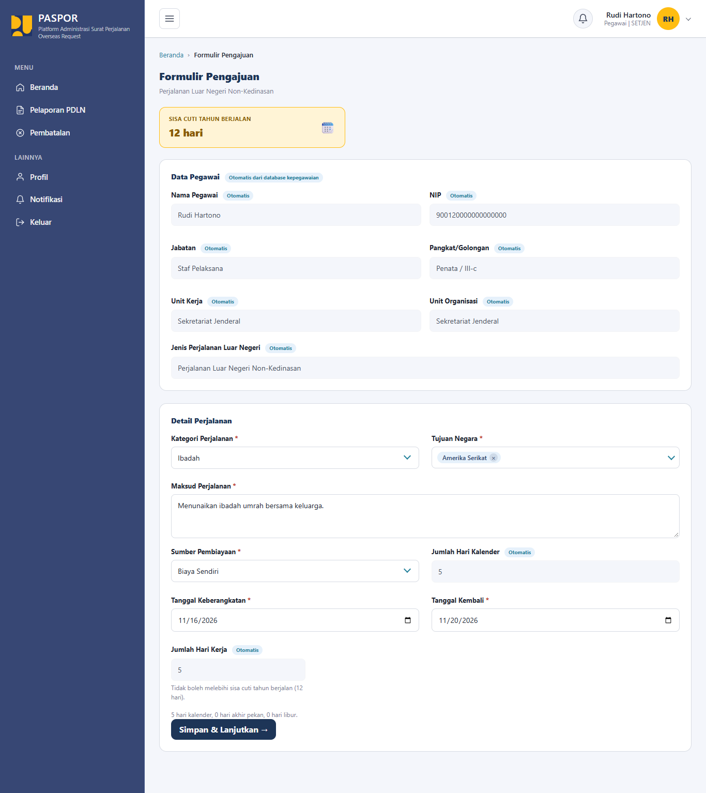

**Formulir PDLN**

- Pilih **Kategori Perjalanan**, lalu **Kegiatan**. Kolom Kegiatan berupa kotak pencarian: ketik minimal 3 huruf (nama kegiatan, penyelenggara, atau kota), lalu pilih dari hasil.
- **Penyelenggara**, **Negara Kegiatan**, **Kota**, dan **Periode Agenda** terisi otomatis dari kegiatan yang dipilih. Negara kegiatan otomatis menjadi negara tujuan, dan Anda boleh menambah negara lain.
- Isi **Tanggal Keberangkatan** dan **Tanggal Kepulangan**. Keberangkatan paling lambat pada tanggal mulai kegiatan, dan kepulangan paling cepat pada tanggal selesai kegiatan.
- Pilih **Sumber Pembiayaan** dan isi **Keterangan Sumber Pembiayaan**.
- Centang pernyataan **"Saya menyatakan data dan formulir yang diisi telah benar"**.
- Klik **Simpan & Lanjutkan**.

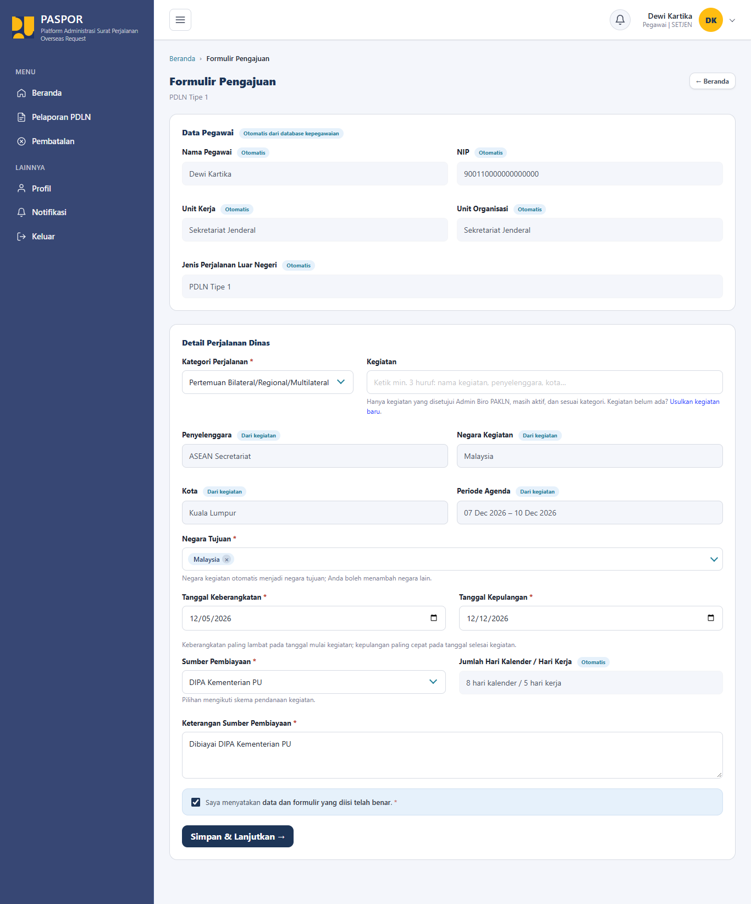

> **Penting:** Perhatikan pesan merah pada kolom yang kosong atau tidak valid, lalu perbaiki sebelum menyimpan. Pilihan kategori dan sumber pembiayaan menyesuaikan tipe pengajuan.

### Langkah 3: Unggah dokumen wajib

Setelah formulir disimpan, Anda diarahkan ke halaman **Unggah Dokumen**. Daftar dokumen wajib **berbeda sesuai jenis dan tipe pengajuan**:

| Jenis / Tipe | Dokumen wajib tahap Pegawai |
|---|---|
| **Non-Kedinasan** | Formulir Persetujuan Cuti Pegawai; Formulir Izin Luar Negeri; Nota Dinas Pimpinan Unit Kerja ke Sekretaris Unor; Dokumen Pendukung |
| **PDLN Tipe 1 dan Tipe 3** | Undangan/Surat Permohonan dari Penyelenggara; Kerangka Acuan Kerja (KAK); RAB Pembiayaan; Jadwal Kegiatan/Itinerary; Nota Dinas Pimpinan Unit Kerja ke Sekretaris Unor |
| **PDLN Tipe 2 Pendidikan** | Letter of Acceptance (LoA); Letter of Guarantee (LoG); Surat Pernyataan sesuai ketentuan Kemensetneg; Daftar Riwayat Hidup (DRH); Perjanjian Ikatan Dinas; Nota Dinas Pimpinan Unit Kerja ke Sekretaris Unor |
| **PDLN Tipe 2 Pelatihan** | Letter of Acceptance (LoA); Kerangka Acuan Kerja (KAK); Surat Pernyataan sesuai ketentuan Kemensetneg; Nota Dinas Pimpinan Unit Kerja ke Sekretaris Unor |

**Cara mengunggah**

1. Pada baris dokumen, klik **Unggah** lalu pilih berkas PDF. Berkas **langsung tersimpan** begitu dipilih; tidak ada tombol simpan terpisah.
2. Bila dokumen meminta **Tanggal Surat** (misalnya Nota Dinas), muncul dialog **Tanggal Surat**. Isi tanggal, lalu klik **Simpan**.
3. Klik **OK** pada pesan "Dokumen berhasil diunggah".
4. Dokumen yang sudah diunggah menampilkan tombol **Pratinjau**, **Hapus**, dan **Ganti**.

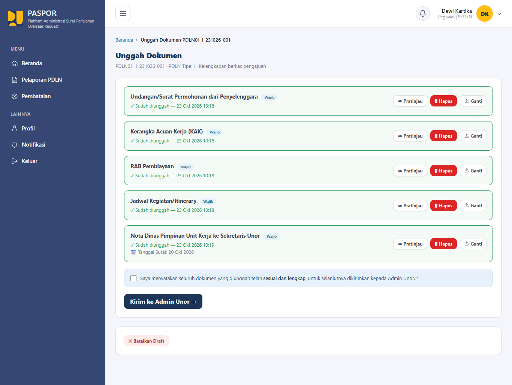

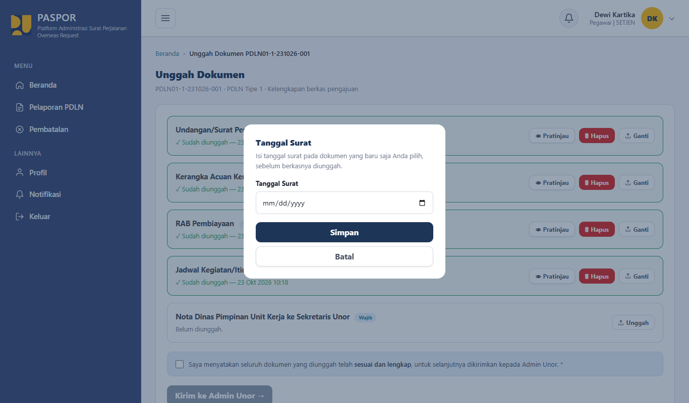

> **Ketentuan berkas:** berkas harus berformat **PDF** dan berukuran maksimal **2 MB**.

### Langkah 4: Kirim ke Admin Unor

1. Pastikan seluruh dokumen wajib sudah terunggah.
2. Centang pernyataan **"Saya menyatakan seluruh dokumen yang diunggah telah sesuai dan lengkap..."**.
3. Klik **Kirim ke Admin Unor**.
4. Status pengajuan berubah menjadi **Dalam Proses Unor**.

> **Penting:** Tombol **Kirim ke Admin Unor** nonaktif selama dokumen wajib belum lengkap. Halaman menampilkan dokumen mana yang masih kurang.

Bila Anda belum mengirim dan ingin membatalkan draft, gunakan tombol **Batalkan Draft** di bagian bawah halaman Unggah Dokumen.

### Langkah 5: Pantau Monitor Progres

1. Di **Beranda**, klik **Lihat Progres** pada pengajuan aktif.
2. Halaman **Monitor Progres** menampilkan negara tujuan, status pengajuan, dan **Timeline Proses** beserta riwayat setiap tahap.

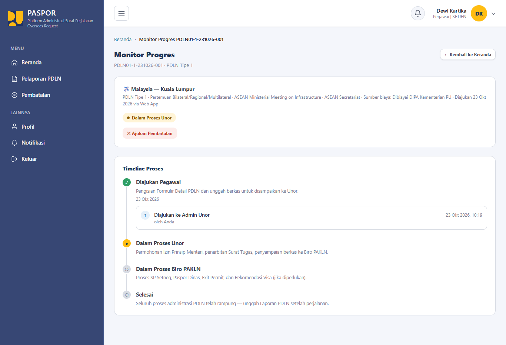

**Jika pengajuan dikembalikan oleh Admin Unor**

1. Di Beranda muncul pesan **"Dikembalikan oleh Admin Unor untuk diperbaiki"** beserta catatannya, dan status pengajuan menjadi **Belum Diajukan**. Anda juga menerima notifikasi.
2. Klik **Lanjutkan Unggah**, lalu perbaiki formulir atau dokumen sesuai catatan.
3. Isi **Catatan perbaikan untuk Admin Unor** (wajib).
4. Centang pernyataan kelengkapan, lalu klik **Kirim ke Admin Unor**.

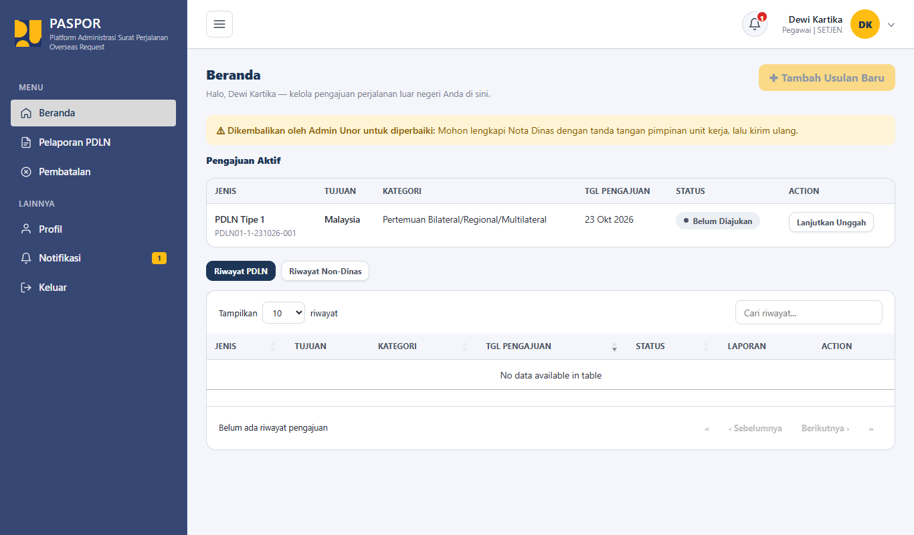

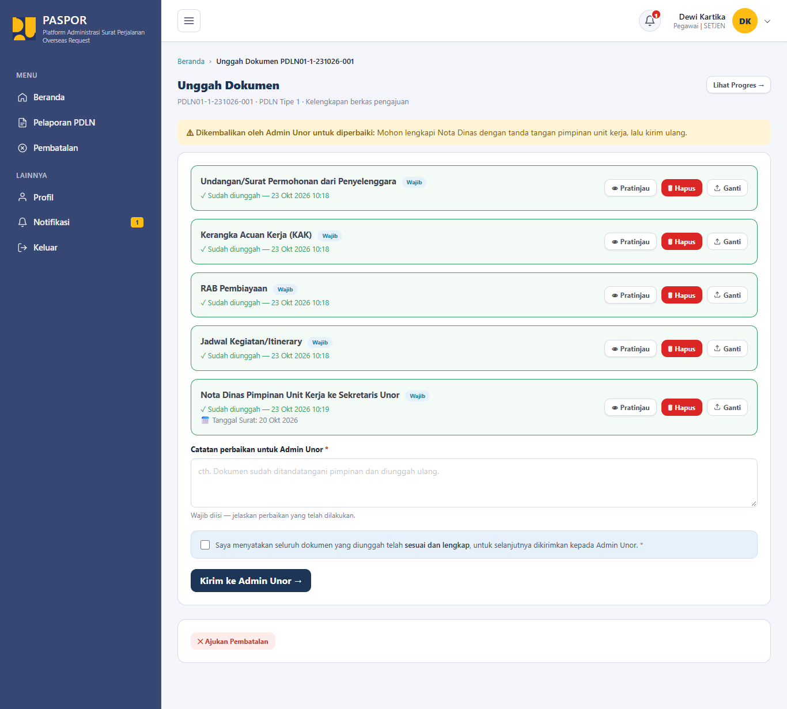

### Langkah 6: Dokumen hasil

Setelah pengajuan berstatus **Selesai**, bagian **Dokumen Hasil PDLN** pada Monitor Progres menyediakan tombol unduh, misalnya **SP Setneg**, **Exit Permit**, **Rekomendasi Visa**, dan **Nota Dinas Karo PAKLN ke Sekretaris Unor**. Dokumen yang tampil mengikuti yang sudah disediakan Biro PAKLN.

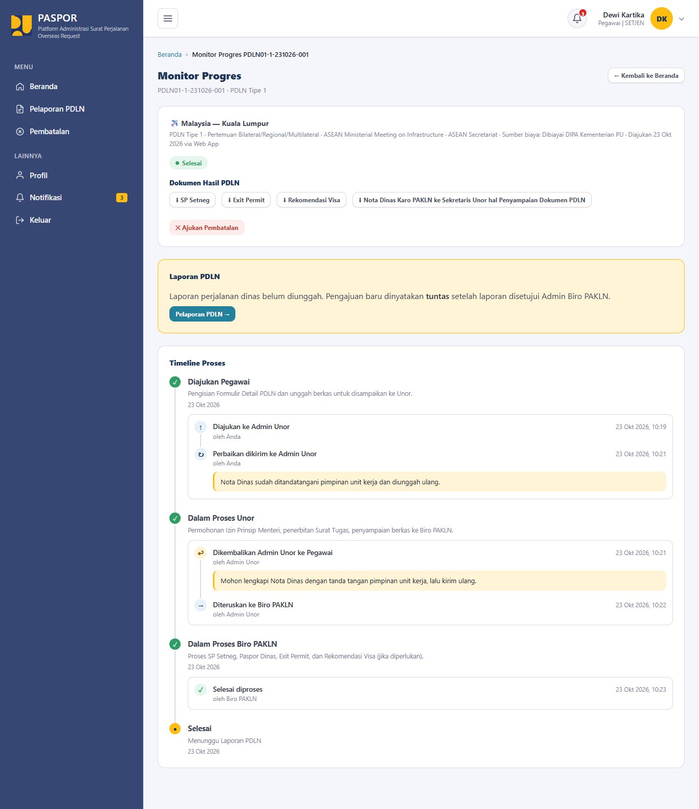

### Langkah 7: Pelaporan PDLN (khusus PDLN)

1. Buka menu **Pelaporan PDLN**, atau klik tombol **Pelaporan PDLN** pada pengajuan yang berstatus Selesai.
2. Pada daftar, klik **Pelaporan PDLN** di baris pengajuan Anda.
3. Isi **Uraian Laporan**: Tujuan Kegiatan, Materi Kegiatan, Tindak Lanjut, dan Dampak Rekomendasi.
4. Isi **Estimasi Biaya (Rp)** dan **Realisasi Biaya (Rp)**.
5. Unggah **Dokumen Laporan Kegiatan** (PDF, maksimal 10 MB).
6. Klik **Simpan** untuk menyimpan sebagai draft (isian boleh belum lengkap), atau **Laporkan** untuk menyampaikan laporan ke Biro PAKLN. Pada dialog konfirmasi, klik **Ya, Laporkan**.
7. Pantau status pada kolom **Status Pelaporan**. Klik **Lihat Laporan** untuk membuka laporan yang sudah dikirim.

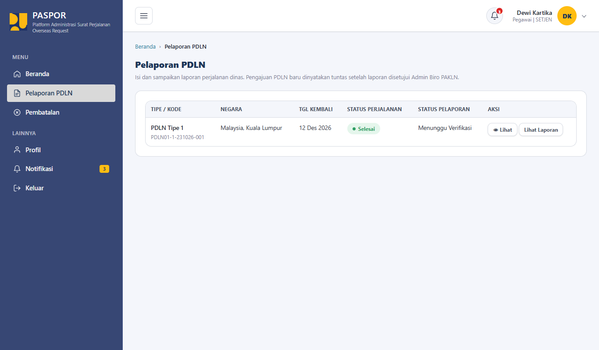

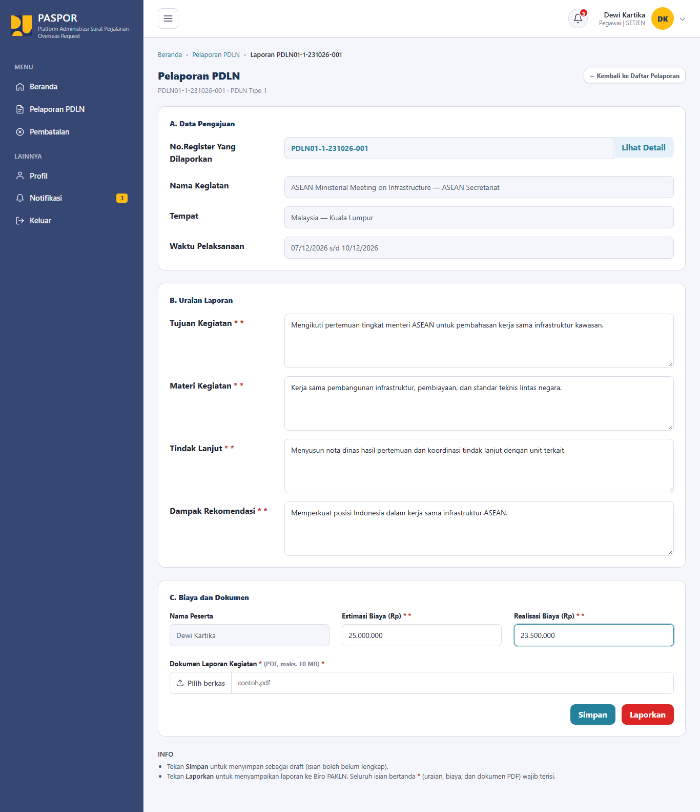

**Jika laporan dikembalikan atau ditolak:** perbaiki laporan, lalu unggah ulang disertai catatan balasan.

> **Penting:** Laporan yang sudah dilaporkan tidak dapat diubah selama proses verifikasi. Untuk PDLN, pengajuan baru dinyatakan **tuntas** setelah laporan disetujui Admin Biro PAKLN. Selama belum tuntas, Anda belum dapat membuat pengajuan baru.

### Langkah 8: Pembatalan

**Mengajukan pembatalan**

1. Buka **Monitor Progres** pada pengajuan yang bersangkutan.
2. Klik **Ajukan Pembatalan**.
3. Isi **Alasan pembatalan** (wajib).
4. Klik **Ajukan Pembatalan** pada dialog.
5. Permohonan dikirim ke Admin Unor, lalu ke Admin Biro PAKLN.

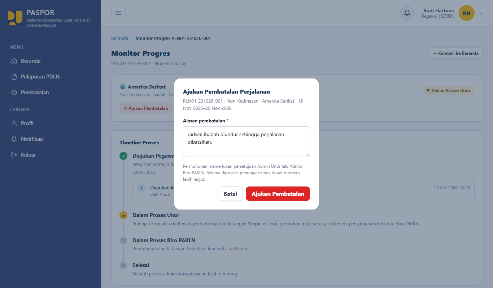

**Memantau atau menarik permohonan**

1. Buka menu **Pembatalan**.
2. Klik **Lihat** untuk melihat rincian permohonan.
3. Klik **Tarik** untuk menarik permohonan yang masih berjalan.

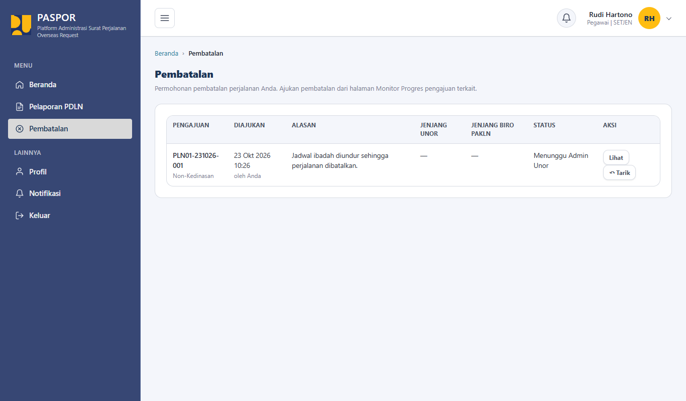

> **Penting:** Selama permohonan pembatalan diproses, pengajuan **dibekukan** dan tidak dapat diproses lebih lanjut. Jika permohonan ditolak atau ditarik, pengajuan melanjutkan proses dari status semula.

---

## 4. Mengusulkan Kegiatan Baru

Untuk pengajuan PDLN, kegiatan dipilih dari daftar kegiatan yang sudah disetujui. Bila kegiatan Anda belum ada:

1. Pada formulir PDLN, di bawah kolom **Kegiatan**, klik **Usulkan kegiatan baru**.
2. Periksa dulu daftar kegiatan agar tidak terjadi duplikat.
3. Isi **Data Kegiatan**: Nama Kegiatan, Deskripsi (opsional), Kategori, Skema Pendanaan, Penyelenggara/Universitas, Negara, Kota, Tanggal Mulai Kegiatan, dan Tanggal Selesai Kegiatan.
4. Isi **Dasar Kegiatan** (wajib, minimal satu): pilih **Jenis Dasar** dan, bila ada, unggah berkas PDF (maksimal 2 MB). Klik **Tambah Dasar** untuk menambah dasar lain.
5. Klik **Kirim Usulan**.

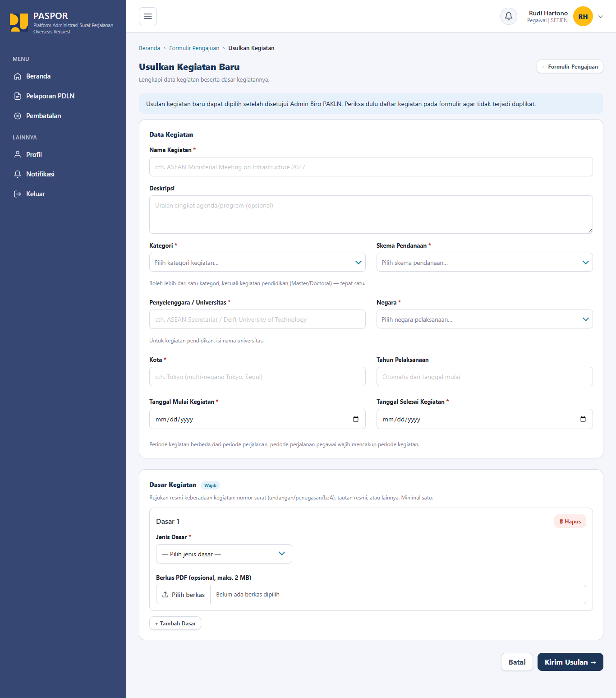

> **Penting:** Usulan kegiatan baru dapat dipilih setelah **disetujui Admin Biro PAKLN**. Status dan catatan keputusan tampil pada bagian **Usulan Kegiatan Saya** di Beranda.
