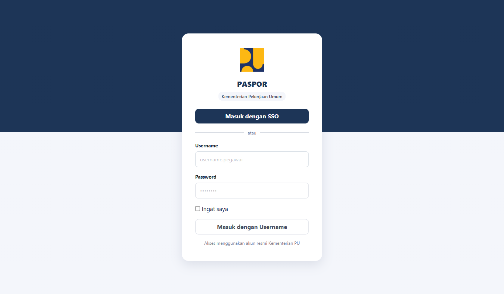
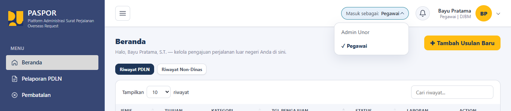
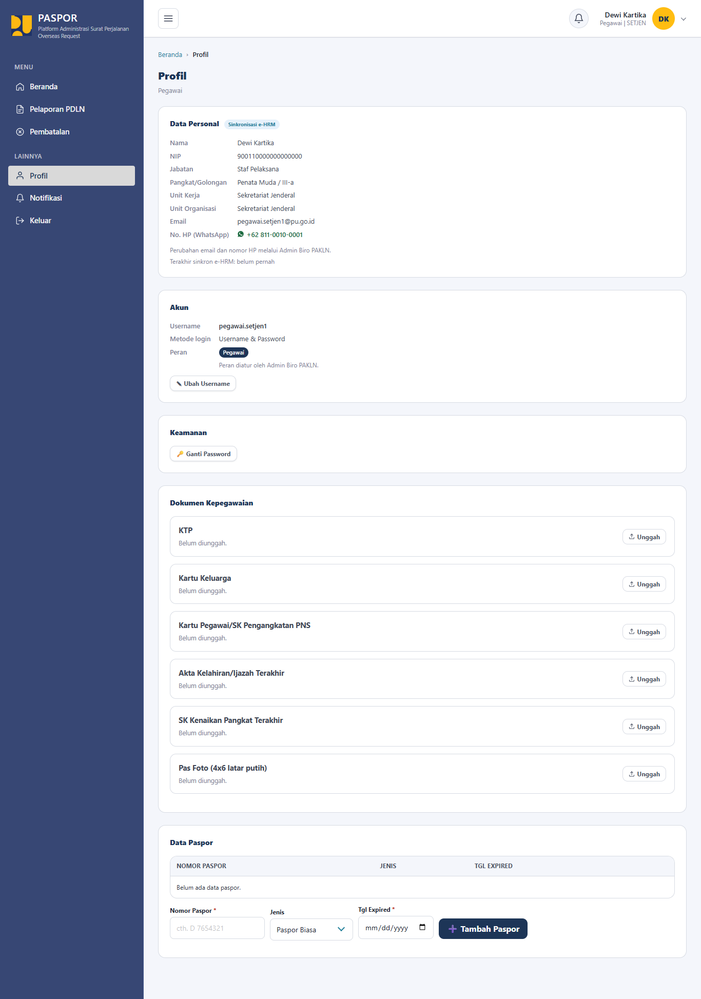
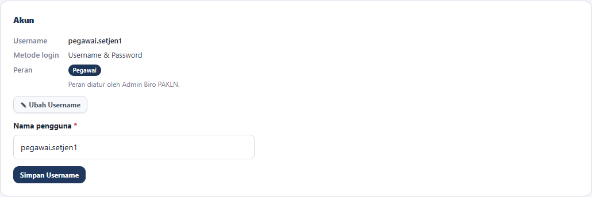
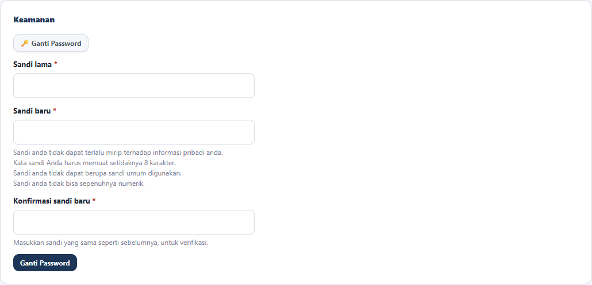
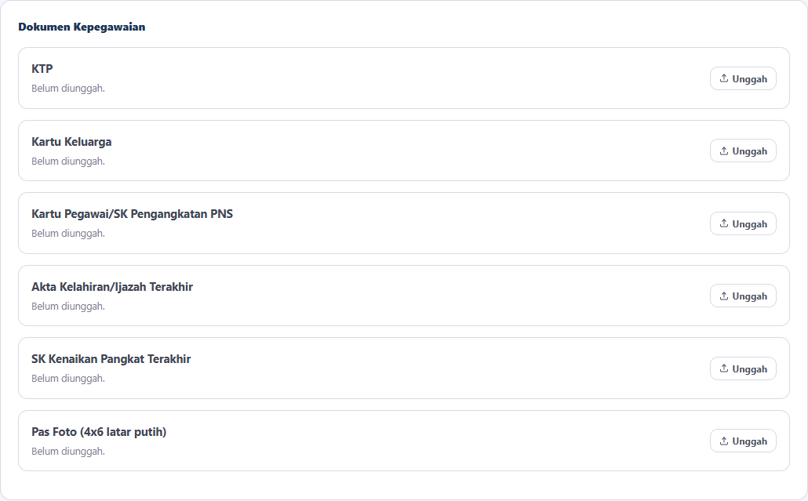
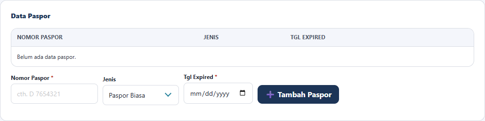
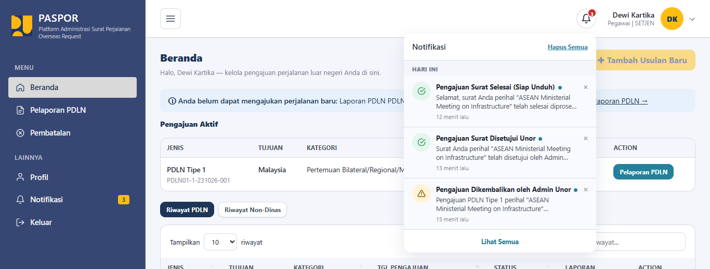
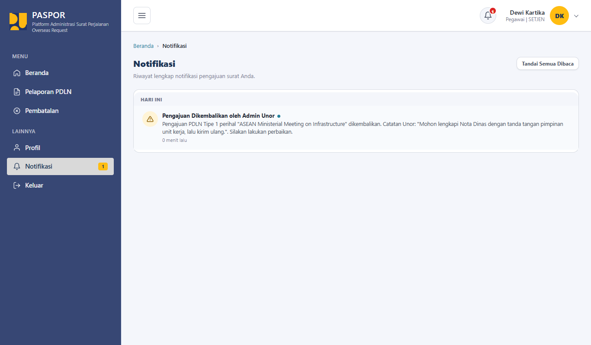

# Buku Panduan Pengguna Paspor PU

Panduan ini menjelaskan cara menggunakan aplikasi **Paspor PU** (Platform Administrasi Surat Perjalanan Overseas Request) bagi dua peran: **Pegawai** dan **Admin Unor**.

## Daftar Isi

1. [Pendahuluan](#1-pendahuluan)
2. [Akses, Akun, dan Profil](#2-akses-akun-dan-profil)
   - [2.1 Login](#21-login)
   - [2.2 Ganti Peran](#22-ganti-peran)
   - [2.3 Profil Pengguna](#23-profil-pengguna)
   - [2.4 Notifikasi](#24-notifikasi)
3. [Panduan Pengguna: Pegawai](pegawai.md)
4. [Panduan Pengguna: Admin Unor](admin-unor.md)
5. [Catatan untuk Penyusun Dokumentasi](#5-catatan-untuk-penyusun-dokumentasi)

---

## 1. Pendahuluan

**Paspor PU** adalah aplikasi untuk mengelola pengajuan **Perjalanan Dinas Luar Negeri (PDLN)** dan **Perjalanan Luar Negeri Non-Kedinasan**. Aplikasi mencatat pengajuan dari pegawai, memprosesnya secara berjenjang, dan menyimpan dokumen serta riwayat pemrosesannya.

Panduan ini bertujuan membantu pengguna menjalankan tugasnya di aplikasi, langkah demi langkah:

| Peran | Gambaran singkat | Panduan |
|---|---|---|
| **Pegawai** | Mengajukan perjalanan, mengunggah dokumen, memantau progres, melaporkan PDLN, dan mengajukan pembatalan. | [pegawai.md](pegawai.md) |
| **Admin Unor** | Memeriksa pengajuan dan dokumen pegawai di unit organisasinya, lalu meneruskan atau mengembalikannya. | [admin-unor.md](admin-unor.md) |

> **Catatan:** Panduan ini hanya memuat fitur untuk kedua peran di atas. Peran lain (Admin BPSDM, Admin BKO, dan Admin Biro PAKLN) tidak dibahas di sini.

---

## 2. Akses, Akun, dan Profil

Bagian ini berlaku untuk **Pegawai** dan **Admin Unor**.

### 2.1 Login

1. Buka halaman login aplikasi.
2. Masukkan **Username** dan **Password**. Centang **Ingat saya** bila diperlukan.
3. Klik **Masuk dengan Username**.
4. Anda diarahkan ke halaman utama sesuai peran: **Beranda** untuk Pegawai dan **Dasbor** untuk Admin Unor.

**Jika Anda belum memiliki password:**

1. Klik **Masuk dengan SSO** pada halaman login.
2. Setelah masuk, buka menu **Profil**.
3. Atur password Anda (lihat [2.3 Profil Pengguna](#23-profil-pengguna)).
4. Selanjutnya Anda dapat masuk dengan username dan password.

> **Penting:** Akun yang belum memiliki password tidak dapat masuk dengan username dan password. Aplikasi akan meminta Anda masuk lewat SSO terlebih dahulu.

Untuk keluar dari aplikasi, klik **Keluar** di bagian bawah sidebar.

### 2.2 Ganti Peran

Pengguna yang memiliki lebih dari satu peran dapat berpindah peran **tanpa login ulang**.

1. Di bagian atas halaman, klik **Masuk sebagai**.
2. Pilih peran yang diinginkan dari daftar. Peran yang sedang aktif diberi tanda centang.
3. Aplikasi menampilkan menu dan halaman sesuai peran yang dipilih.

> **Catatan:** Pengalih peran hanya tampil untuk akun yang memiliki lebih dari satu peran.

### 2.3 Profil Pengguna

Buka menu **Profil** pada bagian **Lainnya** di sidebar.

#### a. Melihat data personal

Bagian **Data Personal** menampilkan data dari e-HRM, antara lain nama, NIP, jabatan, pangkat/golongan, unit kerja, unit organisasi, email, dan nomor HP. Data ini **hanya dapat dibaca (read-only)** dan diperbarui lewat sinkronisasi e-HRM.

> **Catatan:** Email dan nomor HP **tidak dapat diubah sendiri** oleh Pegawai maupun Admin Unor. Perubahan dilakukan melalui **Admin Biro PAKLN**. Pada halaman Profil tertulis: "Perubahan email dan nomor HP melalui Admin Biro PAKLN."

#### b. Mengubah username

1. Pada bagian **Akun**, klik **Ubah Username**.
2. Isi username baru.
3. Klik **Simpan Username**.

Bagian **Akun** juga menampilkan **Metode login** dan **Peran** Anda. Peran hanya dapat diatur oleh Admin Biro PAKLN.

#### c. Mengatur, mengganti, atau menghapus password

Bagian **Keamanan** menampilkan tombol sesuai kondisi akun Anda:

- **Atur Password:** tampil bila akun belum memiliki password. Isi password baru, lalu klik **Simpan Password**.
- **Ganti Password:** tampil bila akun sudah memiliki password.
  1. Klik **Ganti Password**.
  2. Isi **Sandi lama**, **Sandi baru**, dan **Konfirmasi sandi baru**.
  3. Klik **Ganti Password**.
- **Hapus Password:** tampil bila akun juga terhubung dengan SSO. Klik **Hapus Password**, lalu konfirmasi. Setelah dihapus, Anda hanya dapat masuk lewat SSO.

> **Ketentuan sandi baru:** tidak boleh terlalu mirip dengan informasi pribadi Anda, minimal 8 karakter, tidak boleh sandi yang umum digunakan, dan tidak boleh seluruhnya angka.

#### d. Mengunggah dokumen kepegawaian dasar

- **Pegawai** melihat bagian **Dokumen Kepegawaian** dengan enam dokumen: KTP, Kartu Keluarga, Kartu Pegawai/SK Pengangkatan PNS, Akta Kelahiran/Ijazah Terakhir, SK Kenaikan Pangkat Terakhir, dan Pas Foto (4x6 latar putih).
- **Admin Unor** melihat bagian **Dokumen Penugasan** dengan satu dokumen: SK Penugasan Admin.

Langkah mengunggah:

1. Pada baris dokumen yang sesuai, klik **Unggah** (atau **Ganti** bila dokumen sudah pernah diunggah).
2. Pilih berkas, lalu klik **Unggah** untuk menyimpan.
3. Klik **Lihat** untuk melihat berkas yang sudah diunggah.

> **Ketentuan berkas:** berkas harus berformat **PDF** dan berukuran maksimal **2 MB**.

#### e. Mengelola data paspor (khusus Pegawai)

Bagian **Data Paspor** tersedia untuk peran Pegawai.

- **Menambah paspor:** isi **Nomor Paspor**, pilih **Jenis** (Paspor Biasa, Paspor Dinas, atau Paspor Diplomatik), isi **Tgl Expired**, lalu klik **Tambah Paspor**.
- **Menghapus paspor:** klik ikon hapus pada baris paspor, lalu konfirmasi pada dialog "Hapus data paspor ini?".

### 2.4 Notifikasi

Notifikasi memberi tahu Anda bila ada perkembangan pada pengajuan, misalnya pengajuan dikembalikan, disetujui, atau selesai.

**Melihat daftar notifikasi**

- Klik ikon lonceng di bagian atas halaman. Angka merah pada lonceng menunjukkan jumlah notifikasi yang belum dibaca. Daftar notifikasi terbaru tampil sebagai dropdown.
- Klik **Lihat Semua** pada dropdown, atau menu **Notifikasi** di sidebar, untuk membuka halaman Notifikasi lengkap.

**Membuka notifikasi**

Klik sebuah notifikasi untuk membuka halaman terkait pengajuan tersebut.

**Menandai sudah dibaca**

Pada halaman Notifikasi, klik **Tandai Semua Dibaca** untuk menandai seluruh notifikasi sebagai sudah dibaca.

**Menghapus notifikasi**

Pada dropdown lonceng:

- Klik tanda **×** pada sebuah notifikasi untuk menghapusnya.
- Klik **Hapus Semua** untuk menghapus seluruh notifikasi.

---

## 5. Catatan untuk Penyusun Dokumentasi

Seluruh gambar pada panduan ini disimpan di folder `wiki/user-manual/images/` dan ditautkan dengan path relatif dari masing-masing berkas `.md`. Gunakan nama berkas yang deskriptif, misalnya `pegawai-02-beranda.png`.

> **Peringatan:** Jangan memuat **data pribadi asli** (NIP, email, nomor HP, nama pegawai sesungguhnya) pada screenshot. Gunakan hanya akun demo pada database lokal.

### 5.1 Menyiapkan akun demo (database lokal)

1. Pastikan aplikasi berjalan pada **database lokal**, bukan database bersama atau produksi.
2. Jalankan seeder berikut dari folder proyek:
   - `python manage.py seed_demo_data`
   - `python manage.py seed_pegawai_org_units`
   - `python manage.py seed_admin_unor_org_units`
   - `python manage.py seed_kegiatan`
3. Gunakan akun demo hasil seeder:

| Peran | Pola username | Contoh | Password |
|---|---|---|---|
| Pegawai | `pegawai.<alias unor><nomor>` (nomor 1 sampai 3) | `pegawai.setjen1` | `paspor123` |
| Admin Unor | `admin.unor.<alias unor>` | `admin.unor.setjen` | `paspor123` |

> **Catatan:** Ganti `<alias unor>` dengan alias unit organisasi dalam huruf kecil, sesuai data pada database lokal Anda.

> **Peringatan:** Pastikan pengiriman email dimatikan (`MAIL_ALLOW_SEND=false`) saat mencoba alur di database demo, supaya email tidak terkirim ke alamat sungguhan.

### 5.2 Tips pengambilan gambar

- Gunakan lebar jendela dan zoom browser yang sama (100%) agar tampilan konsisten.
- Jalankan satu alur penuh: buat pengajuan sebagai Pegawai, lalu proses sebagai Admin Unor, supaya semua halaman memiliki data contoh.
- Periksa setiap gambar sebelum disimpan dan pastikan tidak ada data pribadi asli yang terlihat.
